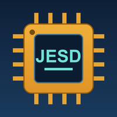

# 半导体标准专家 · semiconductor-standards-master v1.5.0

半导体标准体系认知操作系统（JEDEC / SEMI / IEC / AEC / AQG / IPC / MIL-STD）
—— **用标准做工程判定**，不是查标准。




> ### 📦 关于本仓库的分发范围
>
> 本仓库发布的是**蒸馏层**，**不含任何标准全文**：
>
> | 包含 | 不包含 |
> |---|---|
> | `SKILL.md` 行业 OS + 引用纪律 | 标准 PDF 原件 |
> | 92 条标准的编号库与引用边 | 抽取出的标准全文语料 |
> | 37 份机翻标准的条款级 digest | AQG 324 三版官方 PDF |
> | 军标方法索引（883F/K · GJB 548B/C） | OCR 渲染缓存 |
> | 零依赖 CLI（18 个子命令）+ 六步流水线工具 | |
>
> **标准全文的版权归各标准组织**（JEDEC / IPC / ESDA / IEC / ECPE 等），
> 需自行从官方渠道获取。详见 [LICENSE](LICENSE) 与
> [`references/LOCAL-CORPUS.md`](references/LOCAL-CORPUS.md)（其中标注了每份资料
> 的引用层级：哪些可直接引用、哪些只能用索引）。
>
> 图标 `icons/logo.png` 未随仓库分发（二进制），运行 `python tools/make_icon.py` 生成；
> 矢量源 `icons/logo.svg` 已包含。

---
## 安装

将整个目录放到 skills 目录下即可被识别：

```bash
# Windows（本机实际路径）
cp -r semiconductor-standards-master %USERPROFILE%\.workbuddy\skills\

# Linux / macOS
cp -r semiconductor-standards-master ~/.workbuddy/skills/
```

## ★ 引用纪律（本 skill 最重要的使用前提）

本 skill 挂载了一个**本地标准全文资料库**（52 个标准编号 / 63 份 PDF）。
但**文件名不可信**——实测发现多份标注「完整英文电子版」的文件，正文实为**机翻中文**。

因此资料按 **文档自述 + 实测语种** 分为六层，**引用前必须先定级**：

```bash
python scripts/stdq.py source <编号>   # ← 引用前必跑
```

| 层 | 名称 | 份数 | 可引措辞 | 可引数值 | 规则 |
|---|---|:---:|:---:|:---:|---|
| **L1** | 英文原文在库 | 7 | ✅ | ✅ | 可直接引用，标注编号+版本+页/条 |
| **L2** | 官方中文译本 | 1 | ✅ | ✅ | 可引用，须注明「冲突时以英文版为准」 |
| **L3** | 机器翻译在库 | 37 | ❌ | ✅ | **术语译名禁止引用**（细节见下） |
| **L4** | 扫描件在库未提取 | 4 | ❌ | ❌ | 内容一律不可引；只能声明「已持有」 |
| **L4-OCR** | 扫描件 OCR 后 | 部分 | ⚠ | ⚠ | 可用于理解与索引；**引用前必须人工核对原扫描页** |
| **L0** | 不在库 | — | ❌ | ❌ | **必须声明无法确认** |

**L1 名单**：`JESD47L`（中英对照，英文为原文）、`JESD22-B116B`（英文原件）、`JESD51-2A`、
`JESD51-6`、`IPC-7351`、`IPC-7351B`、`IPC-TM-650-2.4.22c`

## ★ 机翻件（L3）的三个缺陷与三套补救

机翻件不是「差一点」，而是有**三个独立的、实测证实的**缺陷。

### 缺陷 1：术语被译坏 → 补救：术语纠错表

| 机翻译法 | 应为 | 英文原词 | 核实依据 |
|---|---|---|---|
| 「模具垫」 | 芯片焊盘 | `die pad` | B116B 机翻 L95 ↔ 英文 L206 |
| 「模具」 | 芯片 / 裸片 | `die` | B116B 机翻 L202 ↔ 英文 L461 |
| 「球键」 | 球焊点 | `ball bond` | B116B 机翻 L68 ↔ 英文 L149 |
| 「线束」 | 键合线 | `wire bond` | B116B 机翻标题 ↔ 英文标题 |
| 「热膜」 | 热超声 | `thermosonic` | B116B 机翻 L69 ↔ 英文 L153 |
| 「针线」 | 针脚焊点 | `stitch bond` | B116B 机翻 L73 ↔ 英文 L162 |
| 「冶金键」 | 冶金结合 | `metallurgical bond` | B116B 机翻 L67 ↔ 英文 L149 |
| 「骰子」 | 芯片 / 晶粒 | `dice` | J-STD-020 目录 ↔ JEP160 英文标题 |
| 「偏见」/「偏差」 | 偏压 / 偏置 | `bias` | A110E「偏见指南」= Bias Guidelines |

```bash
python scripts/stdq.py terms    # 完整表（10 条，全部对齐英文原件核实）
```

### 缺陷 2：条款号错位（约 20%）→ 补救：确定性还原规则

机翻件的条款号有 **首位数字被移到末尾** 的系统性错位：

| 语料里写的 | 实际应为 | 验证依据 |
|---|---|---|
| `.32` | `2.3` | A104F 上下文夹在 `2.2` 与 `2.4` 之间 |
| `.162` | `2.16` | A104F 第 2 章末条 |
| `.21` | `1.2` | J-STD-020 目录：`1.1范围` → `.21背景` → `.31术语和定义` |

digest 已按规则还原并标注 `（还原）`。**但直接读机翻件原文时看到的条款号是错的。**

### 缺陷 3：表格抽取丢符号 → 补救：数值必须交叉核对

实测 `A104 表1` 的 `H 条件 -55°C` 被抽成 `55°C`、`J/K 的 0°C` 被抽成 `-0`。

### 三套补救的产物

```bash
python scripts/stdq.py digest --all      # 37 份条款级 digest 索引
python scripts/stdq.py digest JESD22-A104F   # 单份：章节结构 + 数值条件 + 术语纠错
```

| 指标 | 数量 |
|---|---|
| 已蒸馏 L3 标准 | 37 份 |
| 提取出的章节条目 | 672（其中 136 需还原条款号，占 20%）|
| 提取出的数值条件行 | 565 |
| 命中的机翻术语错误 | 431 次 |

→ 机翻件从「完全不可用」变成「**可用但需转译**」。

## 目录结构

```
semiconductor-standards-master/
├── SKILL.md                          主文件：17 章行业 OS（触发条件在 frontmatter description）
├── meta.json                         元数据 / corpus / changelog / known_gaps
├── icons/                            logo.png（芯片 + JESD） + logo.svg
├── tools/
│   ├── make_icon.py                  图标生成（纯 Pillow，4x 超采样）
│   ├── verify_skill.py               全量校验 + CLI 回归（含资料库与 digest 一致性）
│   ├── ocr_military.py               ★ 军标 OCR 运行器（逐页落盘/断点续跑/版面还原）
│   └── corpus/                       资料库抽取流水线 + L3 蒸馏器 + README
├── scripts/
│   └── stdq.py                       零依赖 CLI（仅 Python 3 标准库），17 个子命令
├── data/
│   ├── standards.json                92 条标准条目（A 级 38 条）
│   ├── relations.json                57 条引用边 + MIL-STD-883 跨体系映射
│   └── corpus.json                   ★ 本地资料库索引（含引用分层模型）
└── references/
    ├── LOCAL-CORPUS.md               ★ 人读资料覆盖清单（777 行）
    ├── digests/                      ★ 37 份 L3 条款级 digest + _INDEX.md
    ├── synthesis.md                  行业 OS 提炼
    ├── research/                     六轨调研原件（7,070 行 / 561 来源）
    ├── audit/                        审计记录（round1~5）
    └── sources/
        ├── books/                    AQG 324 官方 PDF 三版（CC BY-ND）
        ├── standards/                ★ 49 份标准全文语料（jedec/ 41 · ipc/ 4）
        │   └── mil_ocr/              ★ 军标 OCR 产物 + 进度（可断点续跑）
        ├── corpus_index.json         抽取台账
        └── corpus_metadata.json      文档自述元数据
```

## 快速上手

```bash
S=./scripts/stdq.py

# —— 引用前必跑 ——
python $S source JESD47L        # 某标准的出处/适用范围/引用规则
python $S corpus                # 资料库总览 + 引用分层
python $S coverage              # 按类别的资料覆盖总账
python $S digest --all          # 条款级 digest 索引
python $S terms                 # 机翻术语纠错表

# —— 编号与内容 ——
python $S find JESD22-A104       # 编号 → 内容/条件/CAUTION（自动附资料库层级）
python $S digest JESD22-A104F    # 条款级 digest
python $S check JESD22-A104      # 防错：误传纠正 + 废止拦截
python $S refs IEC60749-34       # 该标准引用了谁
python $S cited-by JEP195        # 谁引用了它
python $S tree 功率循环           # 按失效机理选试验
python $S ql QL-01               # AQG 324 试验条件（一手）
python $S aqg                    # AQG 324 引用构成 + 统计判据 + 文档缺陷
python $S lifetime               # LESIT / Bayerer / Ag烧结寿命公式
python $S unverified             # 29 项未核实（禁止断言）
python $S stats                  # 库统计
```

任何子命令加 `--json` 输出机器可读格式。
`check` / `source` / `digest` 的退出码约定：**有问题 → rc=1**。

## 自检

```bash
python tools/verify_skill.py     # frontmatter/icon/meta/资料库/digest 一致性 + CLI 回归
python tools/make_icon.py        # 重新生成图标
```

## 军标 OCR（含实测约束）

`MIL-STD-883F/K`、`GJB-548B/C` 是纯图像扫描件，合计 **2,229 页**。

**实测速度：36 ~ 236 秒/页**（RapidOCR PP-OCRv3 + onnxruntime CPU；
已试 onnxruntime 1.30.0 / 1.22.0、dpi 100/150/200/300、强制 CPU 与默认 providers 两种配置）。

| 方案 | 预估耗时 | 可行性 |
|---|---|---|
| 全量 OCR（2,229 页） | **22 ~ 75 小时** | ❌ 不可行 |
| 定向 OCR（各军标目录/方法索引，约 80 页） | 1.5 ~ 4 小时 | ⚠ 可行 |

```bash
python tools/ocr_military.py --list                        # 列出待 OCR 军标
python tools/ocr_military.py --std MIL-STD-883K --max-pages 60
python tools/ocr_military.py --std MIL-STD-883K --resume    # 断点续跑
```

**若要全量 OCR**，需换执行环境：① 带 GPU 的机器（onnxruntime-gpu）；或
② 安装 Tesseract（约 1~3 秒/页 → 2,229 页约 1~2 小时）。两者本机都不具备。

## 资料库刷新

```bash
cd tools/corpus
python inventory_sources.py      # ① 去重 + 文本层探测
python extract_corpus.py         # ② 抽文本层（扫描件自动登记 L4）
python extract_metadata.py       # ③ 文档自述元数据（不信文件名）
python build_corpus.py           # ④ 资料库索引
python build_manifest_md.py      # ⑤ 人读覆盖清单
python distill_l3.py             # ⑥ L3 机翻件条款级蒸馏
# 军标：python ../ocr_military.py --std <标准> --resume
```

**三条铁律**：源目录只读 · 不做无核对的 OCR · 不信文件名。

## 重要边界（必读）

1. 凡标 `C｜待人工确认` 的条目**禁止作为断言使用**，查 `stdq unverified`（29 项）。
2. **AQG 324 的 QL-08(HTFB) 与 QL-11(dyn.H3TRB) 参数官方声明未定/未固定**，不可当已定条件写进方案。
3. **AQG 324 文档自身缺陷**：`IEC 60749-6` 版本在第 3 章引用表（2017）与 §9.4 正文（2002）自相矛盾，本 skill 如实记录两处、不代 ECPE 裁决。
4. **JESD22 系列在库均为机翻件**（L3），术语与条款号都不可直接引用。
5. **4 个军标/国军标是纯扫描件**，全量 OCR 不可行；仅有定向 OCR 结果，引用前须核对原页。
6. **加速模型 Ea/h/n 系数全为二手**，AQG 324 只给公式形式，系数须自有数据标定。
7. **A104 在库为 F 版（2020-11），非 F.01**；**JESD47 在库为 L 版（2022-12）**。
8. **本地库不含 IEC 60749 系列正文与 AEC-Q100 正文**。

## 许可

- 本 skill 的结构化数据与文本：随 skill 分发
- `references/sources/books/` 内 AQG 324 PDF：© ECPE e.V.，**CC BY-ND**（禁止演绎/修改分发）
- `references/sources/standards/` 内标准文本：来自用户本地资料库，**版权归各标准组织**
  （JEDEC / IPC / ESDA 等）。仅供内部检索与引用定位，**不得再分发**
